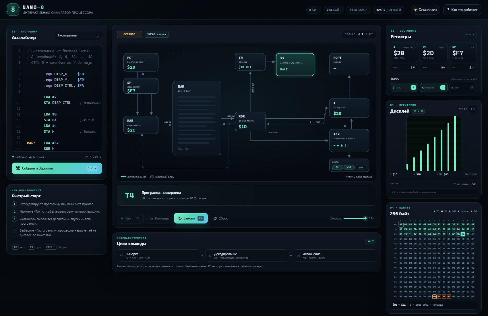

# Nano-8 — интерактивный симулятор процессора

Учебная модель простого **8-битного процессора** с аккумулятором, флагами, стеком, портом вывода, **графическим дисплеем 32×32** и собственным ассемблером. Главная идея — не спрятать процессор в чёрный ящик, а показать его по шагам: от выборки байта из памяти до перехода по флагу.



> Контекст разработки, принятые решения и план продолжения: [NOTES.md](NOTES.md).

## Что внутри

- пошаговое выполнение на уровне **тактов** (микроопераций) и целых команд;
- визуализация тракта данных: PC, MAR, RAM, MDR, IR, УУ, A, АЛУ, флаги, стек;
- подсветка активных регистров и шин на каждом шаге;
- ассемблер с метками, выражениями и директивами;
- **монохромный дисплей 32×32** с отдельной видеопамятью и memory-mapped регистрами;
- 9 готовых программ: циклы, Фибоначчи, умножение, ASCII-строка, сдвиги, стек, битовые операции, гистограмма и диагонали;
- просмотр всех 256 байт памяти, порта вывода и экрана;
- встроенный краткий курс «Как это работает» и таблица системы команд.

Всё работает как статическая страница: без сборки, сервера и внешних зависимостей.

## Быстрый запуск

Откройте `index.html` двойным щелчком в браузере.

Если браузер ограничивает локальные файлы, запустите простой HTTP-сервер из папки проекта:

```bash
python -m http.server 8000
```

и откройте <http://localhost:8000>.

## Управление

| Действие | Клавиша / кнопка |
|---|---|
| Один такт процессора | `F8` или «Такт» |
| Одна команда целиком | «Команда» |
| Запуск / пауза | `F9` или «Запуск» |
| Собрать и сбросить | `Ctrl+Enter` |
| Сброс процессора | «Сброс» |

Редактор поддерживает `Tab` (4 пробела). Примеры выбираются в выпадающем списке над редактором.

## Как устроен Nano-8

| Компонент | Назначение |
|---|---|
| **A** | 8-битный аккумулятор, через него идут все вычисления |
| **PC** | адрес следующей команды, 8 бит, переполняется по модулю 256 |
| **SP** | указатель стека, стартует с `$F7`, стек растёт вниз |
| **MAR** | регистр адреса памяти |
| **MDR** | регистр данных памяти |
| **IR** | регистр текущей команды |
| **УУ** | управляющее устройство: декодирует IR и выбирает микропрограмму |
| **АЛУ** | сложение, вычитание, логика, сдвиги |
| **Флаги Z, C, N** | ноль, перенос/заём, старший бит результата |
| **Порт вывода** | принимает байт по команде `OUT` |
| **Дисплей** | 32×32, 1 бит на пиксель, 128 байт отдельной видеопамяти |

Память — единое пространство на 256 байт: там лежат код, данные, стек и регистры дисплея. Это намеренно маленькая, но полноценная модель: адрес и данные по 8 бит, поэтому все адреса находятся в диапазоне `$00…$FF`.

### Карта памяти

| Диапазон | Назначение |
|---|---|
| `$00–$F7` | код, данные и стек (SP стартует с `$F7`) |
| `$F8` | `DISP_X` — координата X |
| `$F9` | `DISP_Y` — координата Y |
| `$FA` | `DISP_CTRL` — команда дисплея |
| `$FB–$FF` | резерв |

Видеопамять дисплея (128 байт) живёт **отдельно** от адресного пространства процессора. Поэтому экран не отнимает RAM у программы.

### Цикл команды

Каждая команда проходит одинаковые этапы:

1. **Выборка** — `MAR ← PC`, `MDR ← RAM[MAR]`, `IR ← MDR`, `PC ← PC + 1`.
2. **Декодирование** — УУ смотрит на код в IR и выбирает микропрограмму.
3. **Исполнение** — операнд читается из памяти, АЛУ считает, A и флаги обновляются.
4. **Повтор** — если не было `HLT`, цикл начинается снова.

Непосредственный операнд (`LDA #5`) требует одного чтения памяти, прямой (`LDA $20`) — двух: сначала читается адрес, потом значение по этому адресу. Именно поэтому в пошаговом режиме видно, как MAR и MDR используются повторно.

### Флаги

- **Z** — результат равен нулю.
- **C** — перенос при `ADD`, отсутствие заёма при `SUB`/`CMP` (`A >= операнд`), выдвинутый бит при `SHL`/`SHR`.
- **N** — копия старшего бита результата (бит 7).

`LDA` и `POP` обновляют Z и N. `INC`/`DEC` обновляют Z и N, но не трогают C. Логические `AND`/`OR`/`XOR` тоже не меняют C.

## Графический дисплей

Экран имеет размер **32×32 пикселя** (1024 точки) и 1 бит на пиксель. Видеопамять занимает 128 байт и не входит в 256-байтное адресное пространство процессора.

Процессор управляет экраном через три memory-mapped регистра:

| Адрес | Регистр | Смысл |
|---|---|---|
| `$F8` | `DISP_X` | координата X, 0…31 |
| `$F9` | `DISP_Y` | координата Y, 0…31 |
| `$FA` | `DISP_CTRL` | команда дисплею |

Команды записываются обычной инструкцией `STA`:

| Значение | Действие |
|---|---|
| `1` | поставить пиксель в (`X`, `Y`) |
| `2` | очистить экран |
| `3` | стереть пиксель в (`X`, `Y`) |
| `4` | инвертировать пиксель в (`X`, `Y`) |
| `5` | нарисовать вертикальный столбик от `Y` до низа экрана |

Пример:

```asm
.equ DISP_X,    $F8
.equ DISP_Y,    $F9
.equ DISP_CTRL, $FA

        LDA #10
        STA DISP_X
        LDA #20
        STA DISP_Y
        LDA #1
        STA DISP_CTRL    ; пиксель (10, 20)
```

Такой интерфейс выбран специально: у Nano-8 нет индексной адресации, поэтому рисовать напрямую в framebuffer по вычисленному адресу было бы неудобно. Запись в фиксированные I/O-регистры работает с обычными `STA` и позволяет строить циклы и графики.

## Система команд

30 кодов, 23 мнемоники. Операнд `#n` — непосредственное число, `addr` — прямой адрес.

| Код | Команда | Действие | Флаги |
|---|---|---|---|
| `$00` | `NOP` | ничего не делать | — |
| `$01` / `$02` | `LDA #n` / `LDA addr` | `A ← n` / `A ← MEM[addr]` | Z N |
| `$03` | `STA addr` | `MEM[addr] ← A` | — |
| `$04` / `$05` | `ADD #n` / `ADD addr` | `A ← A + операнд` | Z C N |
| `$06` / `$07` | `SUB #n` / `SUB addr` | `A ← A − операнд` | Z C N |
| `$08` / `$09` | `AND #n` / `AND addr` | `A ← A & операнд` | Z N |
| `$0A` / `$0B` | `OR #n` / `OR addr` | `A ← A \| операнд` | Z N |
| `$0C` / `$0D` | `XOR #n` / `XOR addr` | `A ← A ^ операнд` | Z N |
| `$0E` / `$0F` | `CMP #n` / `CMP addr` | `A − операнд → флаги` | Z C N |
| `$10` | `JMP addr` | `PC ← addr` | — |
| `$11` | `JZ addr` | переход, если `Z = 1` | — |
| `$12` | `JNZ addr` | переход, если `Z = 0` | — |
| `$13` | `JC addr` | переход, если `C = 1` | — |
| `$14` | `JNC addr` | переход, если `C = 0` | — |
| `$15` | `JN addr` | переход, если `N = 1` | — |
| `$16` | `INC` | `A ← A + 1` | Z N |
| `$17` | `DEC` | `A ← A − 1` | Z N |
| `$18` | `SHL` | `A ← A << 1`, старший бит в C | Z C N |
| `$19` | `SHR` | `A ← A >> 1`, младший бит в C | Z C N |
| `$1A` | `PUSH` | `MEM[SP] ← A; SP ← SP − 1` | — |
| `$1B` | `POP` | `SP ← SP + 1; A ← MEM[SP]` | Z N |
| `$1C` | `OUT` | отправить A в порт вывода | — |
| `$1D` | `HLT` | остановить процессор | — |

## Синтаксис ассемблера

```asm
; Сумма чисел 1..10
        LDA #0
        STA SUM
        LDA #1
        STA I

LOOP:   LDA SUM
        ADD I
        STA SUM

        LDA I
        CMP #10
        JZ DONE
        INC
        STA I
        JMP LOOP

DONE:   LDA SUM
        OUT
        HLT

SUM:    .byte 0
I:      .byte 0
```

Поддерживается:

- комментарии `;` и `//`;
- метки `LOOP:` (в том числе на отдельной строке);
- числа `10`, `$0A`, `0x0A`, `%1010`, `0b1010`, символы `'A'`;
- выражения `(BASE + 2) * 4`, `MASK & $F0`, сдвиги `1 << 4`;
- директивы:
  - `.org $20` — установить текущий адрес;
  - `.byte 1, 2, 'A', "ok"` — данные;
  - `.string "Hello"` — ASCII-строка;
  - `.equ DISP_X, $F8` — именованная константа без расхода памяти.

Адреса и данные обязаны помещаться в 8 бит. Ассемблер делает два прохода, поэтому метки можно использовать до их определения.

## Примеры

| Пример | Что показывает |
|---|---|
| Сумма 1…10 | цикл, счётчик, `CMP`/`JZ`/`JMP`, результат 55 |
| Фибоначчи | несколько переменных в памяти, 10 чисел |
| Умножение 7 × 6 | умножение через повторное сложение, результат 42 |
| Строка в порт | ASCII-коды и порт вывода, `Hello, 8-bit!` |
| Степени двойки | сдвиг `SHL`, числа 1…128 |
| Стек PUSH / POP | сохранение и восстановление A |
| Битовые операции | `AND`, `OR`, `XOR` над одним байтом |
| Гистограмма | 8 столбиков на дисплее, команды `DISP_X/Y/CTRL` |
| Диагонали | крест из 64 пикселей, цикл и алгоритмическая графика |

## Структура проекта

```text
index.html            разметка и SVG-схема процессора
css/styles.css        оформление, адаптивность, анимации
js/isa.js             система команд и дизассемблер
js/assembler.js       двухпроходный ассемблер и выражения
js/cpu.js             ядро: регистры, память, микропрограммы
js/examples.js        встроенные примеры
js/app.js             интерфейс и визуализация
tests/test-core.js    тесты ядра и ассемблера
tests/ui-smoke.html   smoke-тест интерфейса в headless-браузере
```

## Тесты

```bash
node tests/test-core.js
```

или, если установлен npm:

```bash
npm test
```

Покрыты система команд, директивы `.equ`, метки, выражения, ошибки ассемблера, флаги, стек, переходы, дисплей и все встроенные примеры. Отдельный smoke-тест интерфейса запускается в headless-браузере через `tests/ui-smoke.html`.

## Ограничения модели

Nano-8 намеренно маленький: нет прерываний, ввода, косвенной адресации, подпрограмм `CALL`/`RET` и 16-битных адресов. Дисплей тоже минимальный: 32×32, 1 бит, без спрайтов, вертикальной синхронизации и аппаратной прокрутки. Это не мешает увидеть главное — как процессор выбирает, декодирует и исполняет команды, как работают регистры, шины, АЛУ, флаги, стек и memory-mapped периферия.
